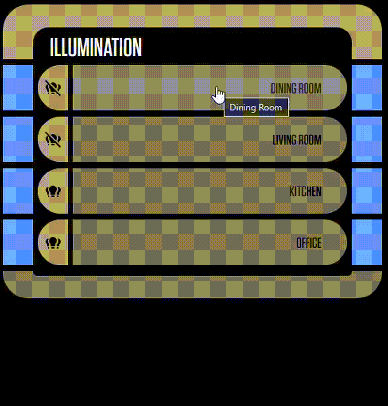

# LCARS Expander Card

A Home Assistant Lovelace custom card with an arbitrary card as its clickable
header and a collapsible grid of cards below it (in the drawer.)

It's fully sytlable using CSS or uix styling.

## Prerequisits

To build the project locally, you need to have Node.js installed.

## Build

From the command line, in the project root directory:

```bach
npm install
npm run build
```

## Install

Copy `dist/lcars-expander-card.js` into Home Assistant's `/config/www/` directory,
then add it as a JavaScript module resource, for example:

```yaml
url: /local/lcars-expander-card.js
type: module
```

## Configuration

```yaml
type: custom:lcars-expander-card
header:
  type: markdown
  content: Header Card
drawer:
  columns: 3
  cards:
    - type: custom:your-card
    - type: entities
      entities:
        - sensor.example
default_expanded: false
tap_action:
  action: none
hold_action:
  action: more-info
  entity: sensor.example
header_style: |
  --ha-card-background: var(--primary-background-color);
  --ha-card-border-radius: 0;
card_style: |
  --ha-card-border-radius: 0;
drawer_style:
  gap: 12px
```

| Option | Description |
| --- | --- |
| `header` | Area where you add the header card. |
| `drawer.cards` | Accepts any number of normal Lovelace card configurations. |
| `drawer.columns` | Number of grid columns; a positive integer. Defaults to `2`. |
| `default_expanded` | Initial state: `true` starts with the drawer expanded; `false`. starts it collapsed. Defaults to `false`. |
| `hold_action` | Uses Home Assistant's standard card action configuration. A normal header click toggles the drawer. |
| `tap_action` | Uses Home Assistant's standard card action configuration. Note: Clicking/tapping the header will toggle the drawer regardless of this setting. |
| `header_style` | CSS declarations applied to the header card element. |
| `card_style` | CSS declarations applied to each drawer card element. |
| `drawer_style` | CSS declarations applied to the drawer content container. |

Style values may be a CSS declaration string or a YAML map. CSS custom
properties such as `--ha-card-background` are inherited by the embedded card,
and are the most reliable way to theme its internals. For selector-based
styling inside third-party cards, use the styling mechanism provided by that
card (for example, card-mod if installed).

## Example

Here's an example of a section that uses the LCARS expander card with standard buttons and styling from [ha-lcars](https://github.com/th3jesta/ha-lcars):

```yaml
type: grid
columns: 2
square: false
gap: 0
padding: 0
cards:
  - type: markdown
    content: '# Illumination'
    uix:
      class: header-contained
  - type: custom:lcars-expander-card
    header:
      type: button
      entity: light.dining_dining
      name: Dining Room
      tap_action:
        action: none
      hold_action:
        action: toggle
      uix:
        class: button-lozenge-left
        sound: true
    drawer:
      columns: 2
      cards:
        - type: button
          entity: light.dining_dinning_room_n
          name: North
          tap_action:
            action: toggle
          uix:
            class: button-lozenge-left
            sound: true
        - type: button
          entity: light.dining_dinning_room_s
          name: South
          tap_action:
            action: toggle
          uix:
            class: button-lozenge-right
            sound: true
        - type: button
          entity: light.dining_dining
          name: All
          tap_action:
            action: toggle
          uix:
            class: button-lozenge-left
            sound: true
    uix:
      class: middle-left middle-right
  - type: custom:lcars-expander-card
    header:
      type: button
      entity: light.living_room_living_room
      name: Living Room
      show_icon: true
      show_name: true
      tap_action:
        action: none
      hold_action:
        action: toggle
      uix:
        class: button-lozenge-left
    drawer:
      columns: 2
      cards:
        - type: button
          entity: light.living_room_living_room_e
          name: East
          tap_action:
            action: toggle
          uix:
            class: button-lozenge-left
            sound: true
        - type: button
          entity: light.living_room_living_room_c
          name: Center
          tap_action:
            action: toggle
          uix:
            class: button-lozenge-right
            sound: true
        - type: button
          entity: light.living_room_living_room_w
          name: West
          tap_action:
            action: toggle
          uix:
            class: button-lozenge-left
            sound: true
        - show_name: true
          show_icon: true
          type: button
          entity: light.living_room_living_room
          name: All
          tap_action:
            action: toggle
          uix:
            class: button-lozenge-right
            sound: true
    uix:
      class: middle-left middle-right
  - type: custom:lcars-expander-card
    header:
      type: button
      entity: light.kitchen_kitchen
      name: Kitchen
      icon: mdi:lightbulb-group
      uix:
        class: button-lozenge-left
        sound: true
      tap_action:
        action: none
      hold_action:
        action: toggle
    uix:
      class: middle-left middle-right
    drawer:
      cards:
        - type: button
          entity: light.kitchen_kitchen_nw
          name: Northwest
          tap_action:
            action: toggle
          uix:
            class: button-lozenge-left
            sound: true
        - type: button
          entity: light.kitchen_kitchen_ne
          name: Northeast
          tap_action:
            action: toggle
          uix:
            class: button-lozenge-right
            sound: true
        - type: button
          entity: light.kitchen_kitchen_w
          name: West
          tap_action:
            action: toggle
          uix:
            class: button-lozenge-left
            sound: true
        - type: button
          entity: light.kitchen_kitchen_e
          name: East
          tap_action:
            action: toggle
          uix:
            class: button-lozenge-right
            sound: true
        - type: button
          entity: light.kitchen_kitchen_sw
          name: Southwest
          tap_action:
            action: toggle
          uix:
            class: button-lozenge-left
            sound: true
        - type: button
          entity: light.kitchen_kitchen_se
          name: Southeast
          tap_action:
            action: toggle
          uix:
            class: button-lozenge-right
            sound: true
        - type: button
          entity: light.kitchen_kitchen
          name: All
          tap_action:
            action: toggle
          uix:
            class: button-lozenge-left
            sound: true
  - type: custom:lcars-expander-card
    header:
      type: button
      entity: light.office_office
      name: Office
      icon: mdi:lightbulb-group
      show_name: true
      show_icon: true
      tap_action:
        action: none
      hold_action:
        action: toggle
      uix:
        class: button-lozenge-left
        sound: true
    drawer:
      columns: 2
      cards:
        - type: button
          entity: light.office_office_s
          name: South
          tap_action:
            action: toggle
          uix:
            class: button-capped-left
            sound: true
        - type: button
          name: a button
          uix:
            class: button-capped-right
            sound: true
    uix:
      class: middle-left middle-right
  - type: markdown
    content: " "
    uix:
      class: footer-contained
column_span: 1
```

The theme used on that dashboard view is `LCARS Naviagtion`.

Here it is in-action:



## License

This project is licensed under the Apache License 2.0. See [LICENSE](./LICENSE)
for the full license text.
